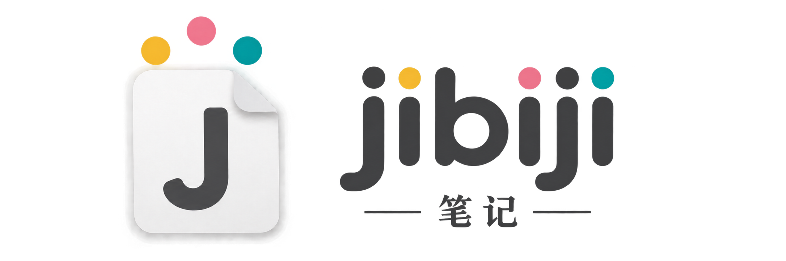
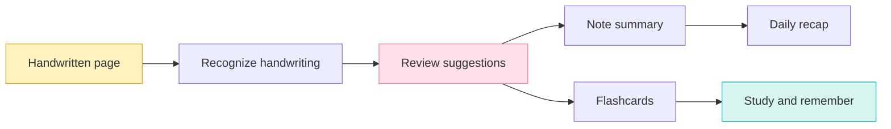

  

  <strong>Write freely. Make sense of it later.</strong> 
  Your handwriting. Clearer notes. A little help remembering.

  <strong>Hangzhou, China</strong> &nbsp; · &nbsp; 中文 / English &nbsp; · &nbsp; Early product planning

  <a href="#the-idea">The idea</a> &nbsp; / &nbsp;
  <a href="#feature-plan">Features</a> &nbsp; / &nbsp;
  <a href="#prototype-scope">Prototype</a> &nbsp; / &nbsp;
  <a href="#milestones">Roadmap</a>

---

Jibiji is a planned AI-assisted tablet app for taking notes in class, based in Hangzhou, China. Whether you are learning a language or studying another subject, turn handwritten pages into readable text, useful summaries, and flashcards, even when your handwriting is messy.

> **We're planning the first prototype.** The features below describe the product we're working toward; they are not available in a released app yet.

| 🟡 Write naturally | 🌸 See the big picture | 🟢 Remember more |
| :--- | :--- | :--- |
| Keep your handwriting and choose from AI suggestions when a word is unclear. | Turn a note or a day's work into a concise, source-linked recap. | Make editable flashcards from your notes and revisit what matters. |

## The idea

Taking notes should not require perfect handwriting or a second session spent organizing everything. Jibiji keeps the original handwriting and helps users understand, review, and remember what they wrote.

Jibiji is for students taking notes in class, whether they are learning a language or studying any other subject. Language learners can capture vocabulary, grammar, and lesson examples; other students can capture explanations, concepts, and class exercises.

The goal is a downloadable app across tablet platforms, including iPadOS and Android, rather than an app tied to one tablet brand. Exact device and operating-system support will be established during development. The initial handwriting recognition should support Chinese and English, including notes that mix both languages, with more languages planned over time.

## Core experience

1. **Write a note.** Write class notes on a tablet with a stylus or finger. Importing a photo of a handwritten page provides another way to capture notes.
2. **Resolve unclear handwriting.** AI recognizes the writing and offers possible readings for uncertain words or characters. Tap a suggestion, enter a correction, or leave the original unchanged.
3. **Review a note summary.** Generate a short overview, key points, and any tasks explicitly recorded in the note.
4. **See the day at a glance.** Get a daily recap of the notes created or edited that day, grouped by topic with links back to the source notes.
5. **Study with flashcards.** Generate editable question-and-answer cards from a note and review them later.

## Feature plan

### Handwriting suggestions

- Preserve the original strokes or image alongside recognized text.
- Highlight uncertain spans and show a few candidate readings in context.
- Let the user accept, dismiss, or manually correct each suggestion.
- Avoid interrupting every pen stroke; start with recognition after a pause or on request.
- Keep unclear text visibly unresolved when there is not enough evidence.

Example: if a handwritten phrase could read “cell division” or “cell diffusion,” Jibiji offers both possibilities for the user to choose from. It should not silently replace the handwriting.

### Note and daily summaries

- Offer an on-demand summary for each note.
- Include a brief overview, key ideas, and explicitly written action items.
- Produce a daily recap at a user-selected time, with Asia/Shanghai as the initial default timezone.
- Define a day using the user's local timezone and include each relevant note once.
- Link summary items to their source notes so users can check the original.
- Label generated summaries and allow regeneration after corrections.

### Flashcards

- Generate cards from a selected note or passage.
- Start with simple question-and-answer cards for definitions, concepts, and facts.
- Let users edit, approve, or delete cards before adding them to a deck.
- Link each card to the source note.
- Offer a basic review screen with “Again” and “Got it” responses.
- Add spaced repetition after the core capture-to-review flow works.

## Prototype scope

The first prototype should prove one complete loop: capture a page, correct its transcription, summarize it, generate cards, and review them.

| Area | First prototype |
| --- | --- |
| Capture | Write class notes on a tablet; import photos of handwritten pages |
| Recognition | Chinese and English transcription with selectable alternatives |
| Notes | Save, rename, edit, and reopen notes |
| Summaries | Per-note summary and a daily recap screen |
| Flashcards | Generate, edit, save, and review question-and-answer cards |
| Organization | Simple notebooks or tags |
| Preferences | Language, timezone, recap time, and AI processing controls |

The primary prototype experience is handwritten note-taking on a tablet. Photo import supports that experience. Collaboration, audio transcription, advanced document formatting, and a full spaced-repetition system are outside the first prototype.

## Suggested screens

- **Home:** recent notes, a new-note button, and today's recap.
- **Note editor:** handwriting or imported page, recognized text, and uncertain-word suggestions.
- **Note review:** summary, key points, source links, and a generate-flashcards action.
- **Daily recap:** the day's topics and recorded tasks, with links to notes.
- **Flashcard deck:** editable cards and a simple study session.
- **Settings:** language, recap schedule, storage, export, and deletion controls.

## Technical starting point

These are proposed components; the stack and model providers are still open.

- **Client:** a downloadable tablet app with a handwriting canvas, page capture, correction, and review. Evaluate a shared implementation for iPadOS and Android, with device compatibility tested before release.
- **Recognition service:** handwriting recognition that returns text, page locations, and candidate readings where supported.
- **AI service:** summaries and flashcards generated from the latest corrected transcription.
- **Storage:** notes, original pages or strokes, transcription versions, summaries, and decks.
- **Background jobs:** recognition, card generation, and daily recap creation.

Suggested data flow:

Corrections should mark older summaries and cards as potentially outdated. AI requests should have clear loading, retry, and failure states, and a failed request should never lose the original note.

## China-first product considerations

- Begin with Simplified Chinese and English, including mixed-language handwriting.
- Test recognition with real handwriting samples, different writing tools, and photographed pages.
- Evaluate model providers, hosting, and latency for users in mainland China.
- Explain when note content leaves the device and obtain user consent before cloud AI processing.
- Decide storage location, retention, export, and deletion behavior before a public launch.
- Get an appropriate review of applicable privacy and data requirements before choosing the production architecture.

## Milestones

1. **Validate the workflow:** sketch the screens and test the concept with a small group of potential users.
2. **Build capture and correction:** save a page, recognize handwriting, and let users resolve uncertain text.
3. **Add useful outputs:** generate note summaries, daily recaps, and editable flashcards.
4. **Run a small pilot:** measure recognition quality, usefulness, response times, and cost.
5. **Prepare for launch:** settle platform support, storage and privacy decisions, reliability, and pricing.

## What success looks like

- Users can complete the full capture-to-flashcard flow without assistance.
- Suggestions make messy handwriting easier to resolve.
- Summaries reflect the source notes without adding unsupported claims.
- Flashcards are useful with minimal editing.
- Original notes remain accessible when AI processing fails.
- Users return to their daily recap and flashcards.

Track correction rate, summary and card edit rate, processing time, cost per processed note, and repeat usage. Set numerical targets after collecting an initial baseline.

## Open decisions

- Which tablet devices and operating-system versions should be supported in the first release?
- Which shared app framework provides the best handwriting experience across tablet platforms?
- Which recognition and language models work best for Chinese and English notes?
- Should daily recaps run automatically or only when requested?
- Which languages should be supported after Chinese and English?
- What should work offline?
- What business model fits the intended users?

---

Jibiji's goal: help people capture ideas in their own handwriting and turn those notes into something they can use every day.
