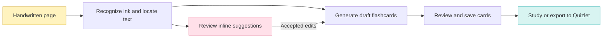

  

  <strong>Write naturally. Study what you wrote.</strong> 
  Your handwriting. Quiet suggestions. Flashcards from class.

  <strong>Hangzhou, China</strong> &nbsp; · &nbsp; 中文 / English &nbsp; · &nbsp; Early product planning

  <a href="#the-idea">The idea</a> &nbsp; / &nbsp;
  <a href="#feature-plan">Features</a> &nbsp; / &nbsp;
  <a href="#prototype-scope">Prototype</a> &nbsp; / &nbsp;
  <a href="#milestones">Roadmap</a>

---

Jibiji is a planned handwriting-first app for students taking Mandarin class notes. Write with Apple Pencil Pro on an iPad Air (M4), get quiet help with incomplete or uncertain writing, and turn useful material from your pages into flashcards.

> **We're planning the first prototype.** This repository currently contains the product brief and branding. The app and Xcode project are planned.

| 🟡 Write naturally | 🌸 Get help in place | 🟢 Remember more |
| :--- | :--- | :--- |
| Mix Chinese characters, pinyin, English, and handwritten annotations on the same page. | Review a tentative completion or correction alongside the ink it refers to. | Generate editable study cards and export them for Quizlet. |

## The idea

A student may hear a word in class, jot down approximate pinyin and an English gloss, and keep writing. The same page might contain a 成语, a grammar pattern with an example sentence, or arrows linking a character to related words. Jibiji lets the student keep that layout and turns those details into material they can study later.

The first release targets Mandarin learners using a native iPadOS app built in Xcode with Swift, SwiftUI, and PencilKit. We’ll validate the writing and recognition experience on an iPad Air (M4) with Apple Pencil Pro. An iPhone companion for studying saved cards is a later milestone.

## Core experience

1. **Write a note.** Use Apple Pencil to write characters, pinyin, English glosses, examples, arrows, and side notes anywhere on the page.
2. **Review a suggestion.** After a writing pause or on request, a likely completion or correction appears faintly in place. Tap to accept it, dismiss it, edit it, or see alternatives.
3. **Keep control of the page.** Save and reopen the original ink with any accepted additions. Undo an accepted change to restore the previous view.
4. **Study what you wrote.** Generate draft cards automatically from a selected page or passage. Review and edit them, save them to a deck, and study on iPad or export for Quizlet.

## Feature plan

### Handwriting suggestions

- Use the ink and nearby context to propose missing characters, pinyin tones, or meanings and flag likely mistakes or ambiguous readings.
- Anchor the proposal to the relevant writing. Keep it visually provisional, avoid interrupting active writing, and leave low-confidence text unresolved when evidence is weak.
- Offer accept, reject, edit, and alternatives. Store accepted changes separately from the original strokes and make them undoable.
- Start with legible provisional text. A small library of roughly five to ten handwriting-style fonts with a suitable match for AI additions is a low-priority refinement.

For example, if the page says `fùzé` and `responsible for?`, Jibiji could offer `负责` and suggest `to be responsible for` as a gloss. The student decides whether to keep either suggestion.

### Flashcards

| Note content | What a card can capture |
| :--- | :--- |
| Vocabulary and expressions | Characters, pinyin, meaning, and a written example where available |
| Idioms (成语) | The idiom, its meaning, and a usage example from the note |
| Grammar | A pattern, what it expresses, and an example or fill-in-the-blank prompt |
| Character components and related words | An explicitly annotated component or link, such as `预` highlighted in `预习` with arrows to related vocabulary |
| Classical Chinese and register | The annotated sense and its label, such as `与` → `和 in this Classical Chinese (古汉语) example` |

- Read handwritten layout cues such as arrows, circles, and nearby labels when the connection is clear. Treat word associations as associations and flag ambiguous links for review.
- Use original ink and confirmed edits as sources. Keep each draft linked to the source page or region, and surface uncertainty for incomplete notes or unconfirmed readings.
- Let students edit, approve, or discard draft cards, group approved cards into decks, and review them on iPad.
- Export approved cards as UTF-8 tab-separated text, with a tab between the front and back and one card per line. Paste the exported text into the [Quizlet website’s import tool](https://help.quizlet.com/hc/en-us/articles/360029977151-Creating-sets-by-importing-content).

## Prototype scope

The first prototype proves the loop from handwritten ink to one reversible suggestion and a usable study card. The first engineering milestone is a smaller experiment on handwriting capture, persistence, and recognition.

| Area | First prototype |
| --- | --- |
| Capture | Write, erase, and undo with Apple Pencil on a PencilKit page |
| Notes | Save and reopen the page with its original strokes intact |
| Recognition | Test real notes that mix Simplified Chinese, pinyin, and English |
| Suggestions | Show a provisional inline completion or correction with accept, reject, alternatives, edit, and undo |
| Flashcards | Generate source-linked drafts, edit and approve them, save to a deck, and review |
| Export | Verify that a deck with Chinese characters and pinyin imports into Quizlet from tab-separated text |

**Later milestones** include iPhone study access, richer review tools, and optional previews of reorganized notes. Automatic note reorganization is out of scope for the MVP.

## Suggested screens

- **Home** lists recent notes and offers a new-note action.
- **Note editor** shows the handwriting canvas and inline suggestions.
- **Card review** shows draft cards alongside links to their source notes.
- **Flashcard deck** offers editing, a basic study session, and Quizlet export.

## Technical starting point

- **Client** uses SwiftUI for the app and [PencilKit](https://developer.apple.com/documentation/pencilkit) for ink capture and rendering.
- **Recognition** starts with a device experiment. Evaluate [`PKStrokeRecognizer`](https://developer.apple.com/documentation/pencilkit/pkstrokerecognizer) where the installed SDK and target iPadOS version support it. Measure recognition of mixed Chinese, pinyin, and English and check what stroke or region references are available.
- **AI** uses recognized text and page context for suggestions and card extraction. Choose a runtime model after comparing quality, latency, cost, and availability. Keep note capture and saving usable if an AI request fails.
- **Storage** keeps original drawings, source locations, accepted changes, and decks. Flag linked cards for review if their source content changes.

## China-first product considerations

- Use real mixed-language notes to evaluate recognition and suggestion quality.
- Compare model availability and latency for users in mainland China.
- Explain what leaves the device and ask for consent before sending notes to a cloud AI service.
- Decide how note retention, export, and deletion should work before a public launch.

## Milestones

1. **Test ink recognition.** Capture, save, and reopen PencilKit drawings. Test actual classroom handwriting on the target iPad and record errors by language and annotation type.
2. **Make the notebook reliable.** Build the basic page lifecycle, writing, erasing, and undo.
3. **Prove inline suggestions.** Start with a controlled example, test every review action, then evaluate context-based suggestions on real notes.
4. **Add the study workflow.** Generate cards across the target categories, review them, and verify Quizlet import.
5. **Pilot and extend.** Test in real classes and follow with iPhone access to saved study cards.

## Working together in Xcode and GitHub

GitHub is the team's shared codebase and project brief. A repository maintainer grants each teammate access. Each teammate clones the same repository to their own Mac using [Xcode’s Git integration](https://developer.apple.com/documentation/xcode/configuring-your-xcode-project-to-use-source-control) or Git, then opens the shared Xcode project once it exists.

1. Pull the latest `main` and create a branch for one task.
2. Make and test changes locally. Commit and push the branch to GitHub.
3. Open a pull request against `main` for teammate review and merge.
4. Pull the merged `main` into each local copy. A push shares the branch. A merge and pull bring the approved changes into everyone’s working copy.

## What success looks like

- A student can write, save, and reopen a page with the original ink intact.
- Suggestions appear in the right place without breaking writing flow. Users can dismiss a bad suggestion and undo an accepted one.
- Cards capture the meaning and relationships written in the notes, including a Classical Chinese annotation and a character relationship, with minimal editing.
- Chinese characters and pinyin survive Quizlet import. Notes remain available when recognition or AI is unavailable.

Track recognition errors by writing type, suggestion usefulness and latency, and how often cards need edits. Set numerical targets after the first device baseline.

## Open decisions

- Which Xcode and iPadOS versions will the team target after the recognition experiment?
- How reliably can we recognize mixed handwriting and anchor suggestions to the relevant ink?
- Which AI provider meets the quality, latency, privacy, and cost targets?
- Which recognition and study features should work offline? How should saved decks reach iPhone later?

---

Jibiji helps Mandarin learners keep writing in class and turn what they wrote into something they can study.
